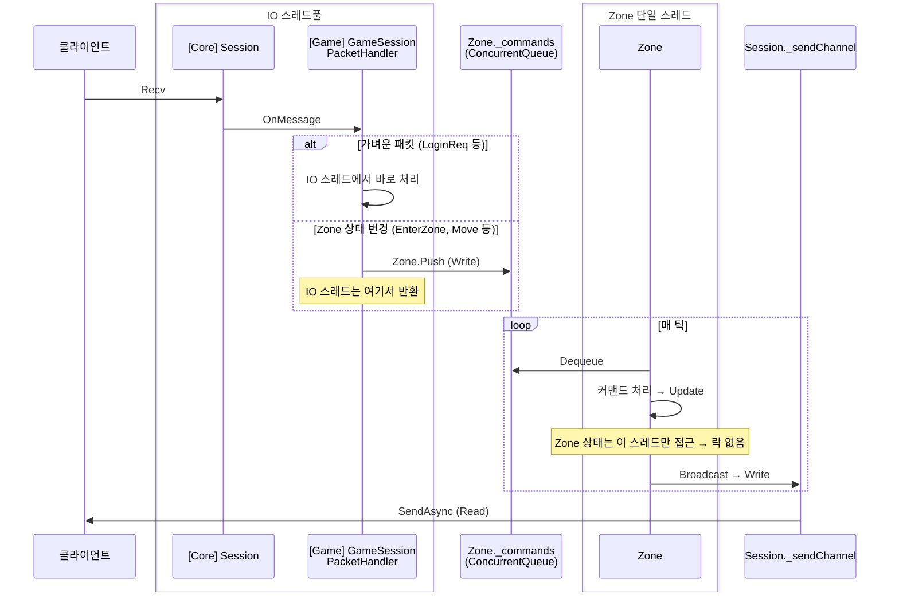

# hCS

C# 실시간 게임 서버 - 네트워크 계층부터 AOI, 부하 측정까지 구현.

> 🔗 다른 프로젝트 : **[hCPP](https://github.com/noeyah/hCPP)** - C++ IOCP 서버 라이브러리 + C# 네트워크 라이브러리


<p align="center">
  
</p>
<p align="center"><sub>윈폼 클라이언트 – 자기 시야(3×3 셀)만 렌더</sub></p>

<br>

## 🔍 요약

| 구분 | 내용 |
|---|---|
| 핵심 | System.IO.Pipelines 기반 네트워크 + IO 스레드풀 / Zone 단일 스레드 분리 + 셀 기반 AOI |
| 성과 | 3,000 커넥션 이동 중 20Hz 유지, 틱당 할당 10.5MB → 0.7MB, Gen2 GC 12회 → 0회 |
| 언어 | C# (.NET 10) |
| 라이브러리 | [MemoryPack](https://github.com/Cysharp/MemoryPack) (패킷 직렬화), WinForms (테스트 클라이언트) |
| 환경 | Windows, Visual Studio 2026 |
| 기간 | 2026년 7월 |
| AI 사용 | 설계, 구현 전반에 활용 ([프로젝트별 범위](#프로젝트-구성-및-구현-범위)) |

<br>

## 프로젝트 구성 및 구현 범위

| 프로젝트 | 역할 | 구현 범위 |
|---|---|---|
| **Core** | Socket과 System.IO.Pipelines 기반 네트워크 라이브러리 | AI 협업 설계, 직접 작성 + AI 작성 |
| **Shared** | 클라이언트와 서버의 공통 데이터 및 MemoryPack 프로토콜 | 공통 코드 |
| **TestServer** | Core를 사용하는 게임 서버, Zone 및 AOI 구현 | AI 협업 설계, 직접 작성 + AI 작성 |
| **TestClient** | AOI 동작을 시각적으로 확인하는 WinForms 클라이언트 | AI 작성 |
| **TestDummy** | 다중 접속과 이동 부하를 생성하는 헤드리스 봇 | AI 작성 |

## Core 설계

- **비동기 수신 :** TCP Socket으로 받은 데이터를 `PipeWriter`에 기록하고, `PipeReader`에서 패킷 단위로 소비
- **패킷 프레이밍 :** `[2바이트 payload 길이][payload]` 형식으로 TCP 스트림의 분할 및 병합 수신 처리
- **송신 직렬화 :** 세션별 `Channel<ReadOnlyMemory<byte>>`과 단일 송신 루프로 패킷 순서 보장

## TestServer 설계

- **스레드 역할 분리 :** 네트워크 IO는 스레드풀에서 처리하고, 게임 상태 변경은 전용 Zone 스레드에서 처리
- **커맨드 큐 :** IO 스레드에서 받은 이동, 입장, 퇴장 요청을 `ConcurrentQueue`로 전달해 Zone 내부 상태를 단일 스레드에서만 변경
- **AOI :** 맵을 셀로 분할하고 현재 셀과 인접 8개 셀만 관심 영역으로 관리해 불필요한 브로드캐스트 감소
- **시야 동기화 :** 플레이어별 관심 대상 집합을 저장하고 셀 이동 시 새로운 관심 영역과 비교해 Enter 및 Leave 대상만 전송
- **이동 브로드캐스트 :** 같은 셀에서 발생한 이동 정보를 하나의 패킷으로 묶어 인접 셀의 플레이어에게 전송
- **패킷 공유 :** 직렬화와 프레이밍을 한 번만 수행한 패킷을 여러 세션에 공유해 브로드캐스트 할당 감소
- **부하 측정 :** 틱 처리량, 작업 수, 송신량, 틱당 할당량, GC 횟수 및 틱 지연을 주기적으로 출력

### 스레드 모델



## 측정 결과
> Release / 루프백 / 3,000 커넥션 / 지속적으로 이동 / 목표 20Hz

| 지표 | before | after | 방법 |
|---|---|---|---|
| 틱당 할당 | 10.5MB | 0.70MB | 송신 버퍼를 수신자끼리 공유 (15배↓) |
| Gen2 GC | 12회 | 0회 | AOI 도입으로 브로드캐스트 축소 |

- 3,000 커넥션 이동 처리 중에도 목표 틱 20Hz 유지

## 버그 해결: AOI 유령 버그

셀 경계를 넘을 때 일부 더미가 화면에 남는 버그.
- **원인:** 같은 틱에 두 명이 셀을 이동하면 Leave를 '이동 후 셀' 기준으로 계산해 서로를 못 찾음
- **해결:** 플레이어별 이전 시야(`HashSet`)와 새 3×3을 비교하도록 변경 → 처리 순서와 무관, 3,000 더미로 소멸 확인

## 실행
```bash
# 빌드
dotnet build hCS.slnx -c Release

# 서버
dotnet run --project TestServer -c Release

# 윈폼 클라이언트
dotnet run --project TestClient -c Release

# 부하 봇
dotnet run --project TestDummy -c Release
```
> 호스트/포트/커넥션 수 등 설정값은 각 프로젝트의 `appsettings.json`에서 조정 가능.
